# Kleos Brand Kit

**Mission:** make being right count more than being rich.
<br>
**Product:** a prediction market with a verifiable reputation layer, on Monad.
<br>
**This kit:** official logos, tier laurels, colors, typography, icons and usage guidelines.

*Kleos* is the Greek word for the glory you earn through your deeds. The laurel is the brand: it fills in, dot by dot, as a trader's reputation grows.

<br>

## Logo

| Variant | Full logo | Full logo with background | Compact logo | Compact with background |
|---|---|---|---|---|
| **Primary** (on dark) | <p align="center">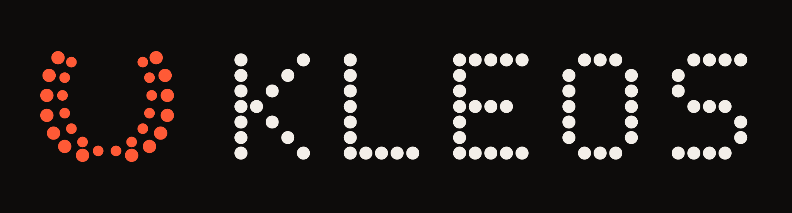<br>[svg](logos/full-logo/full-logo-primary.svg) / [png](logos/full-logo/full-logo-primary.png)</p> | <p align="center"><br>[svg](logos/full-logo/full-logo-primary-bg.svg) / [png](logos/full-logo/full-logo-primary-bg.png)</p> | <p align="center">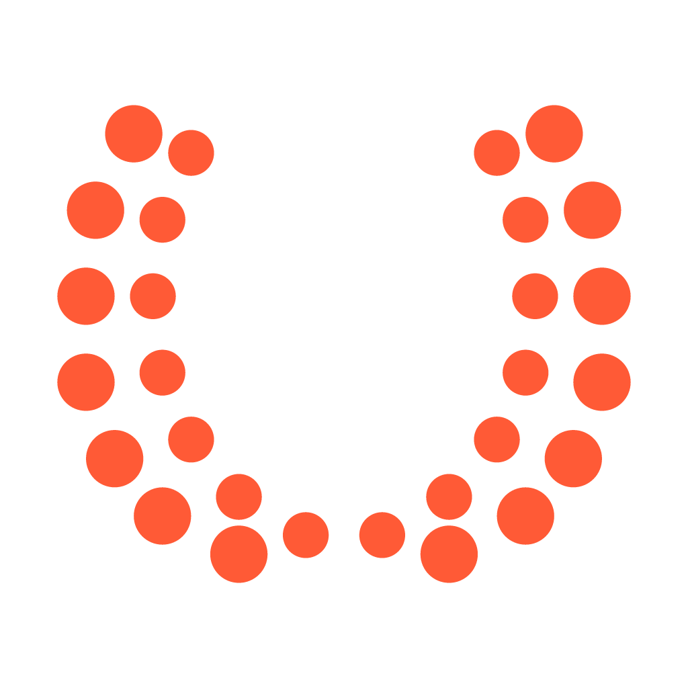<br>[svg](logos/compact-logo/compact-logo-primary.svg) / [png](logos/compact-logo/compact-logo-primary.png)</p> | <p align="center">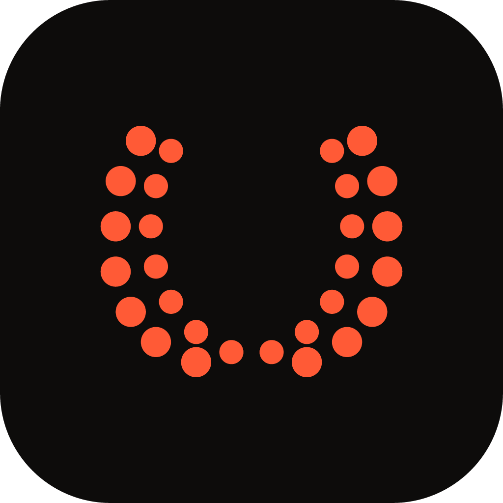<br>[svg](logos/compact-logo/compact-logo-primary-bg.svg) / [png](logos/compact-logo/compact-logo-primary-bg.png)</p> |
| **Coral** | <p align="center">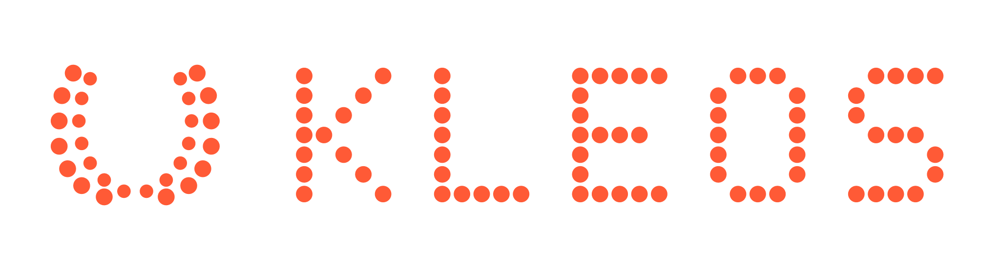<br>[svg](logos/full-logo/full-logo-coral.svg) / [png](logos/full-logo/full-logo-coral.png)</p> | <p align="center">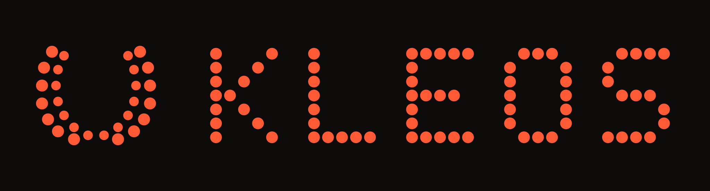<br>[svg](logos/full-logo/full-logo-coral-bg.svg) / [png](logos/full-logo/full-logo-coral-bg.png)</p> | <p align="center"><br>[svg](logos/compact-logo/compact-logo-coral.svg) / [png](logos/compact-logo/compact-logo-coral.png)</p> | <p align="center"><br>[svg](logos/compact-logo/compact-logo-coral-bg.svg) / [png](logos/compact-logo/compact-logo-coral-bg.png)</p> |
| **Black** (on light) | <p align="center">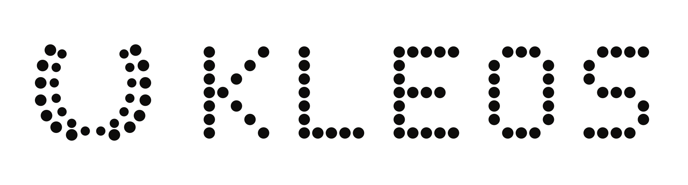<br>[svg](logos/full-logo/full-logo-black.svg) / [png](logos/full-logo/full-logo-black.png)</p> | <p align="center"><br>[svg](logos/full-logo/full-logo-black-bg.svg) / [png](logos/full-logo/full-logo-black-bg.png)</p> | <p align="center">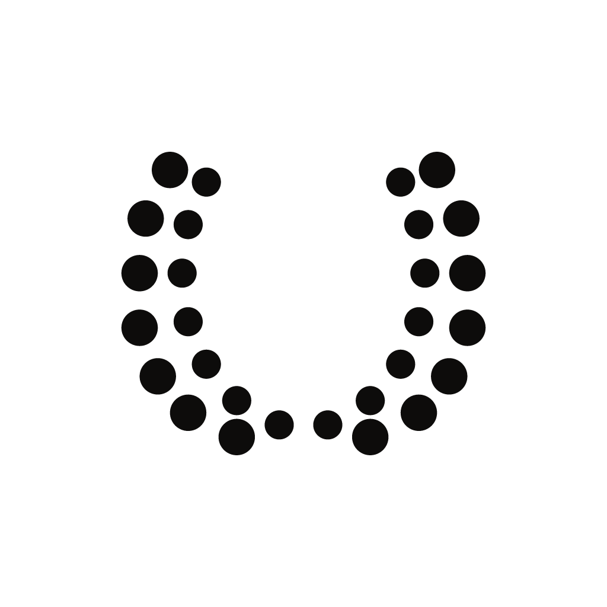<br>[svg](logos/compact-logo/compact-logo-black.svg) / [png](logos/compact-logo/compact-logo-black.png)</p> | <p align="center"><br>[svg](logos/compact-logo/compact-logo-black-bg.svg) / [png](logos/compact-logo/compact-logo-black-bg.png)</p> |
| **White** (on coral or dark) | <p align="center">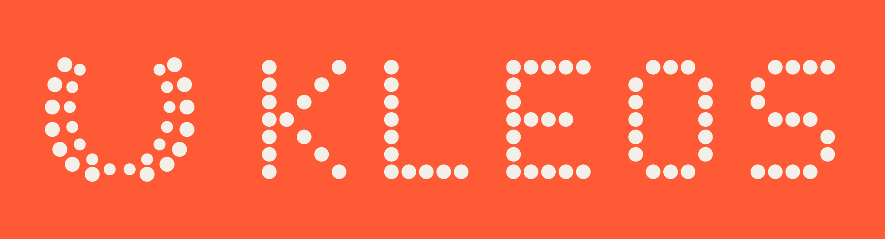<br>[svg](logos/full-logo/full-logo-white.svg) / [png](logos/full-logo/full-logo-white.png)</p> | <p align="center"><br>[svg](logos/full-logo/full-logo-white-bg.svg) / [png](logos/full-logo/full-logo-white-bg.png)</p> | <p align="center">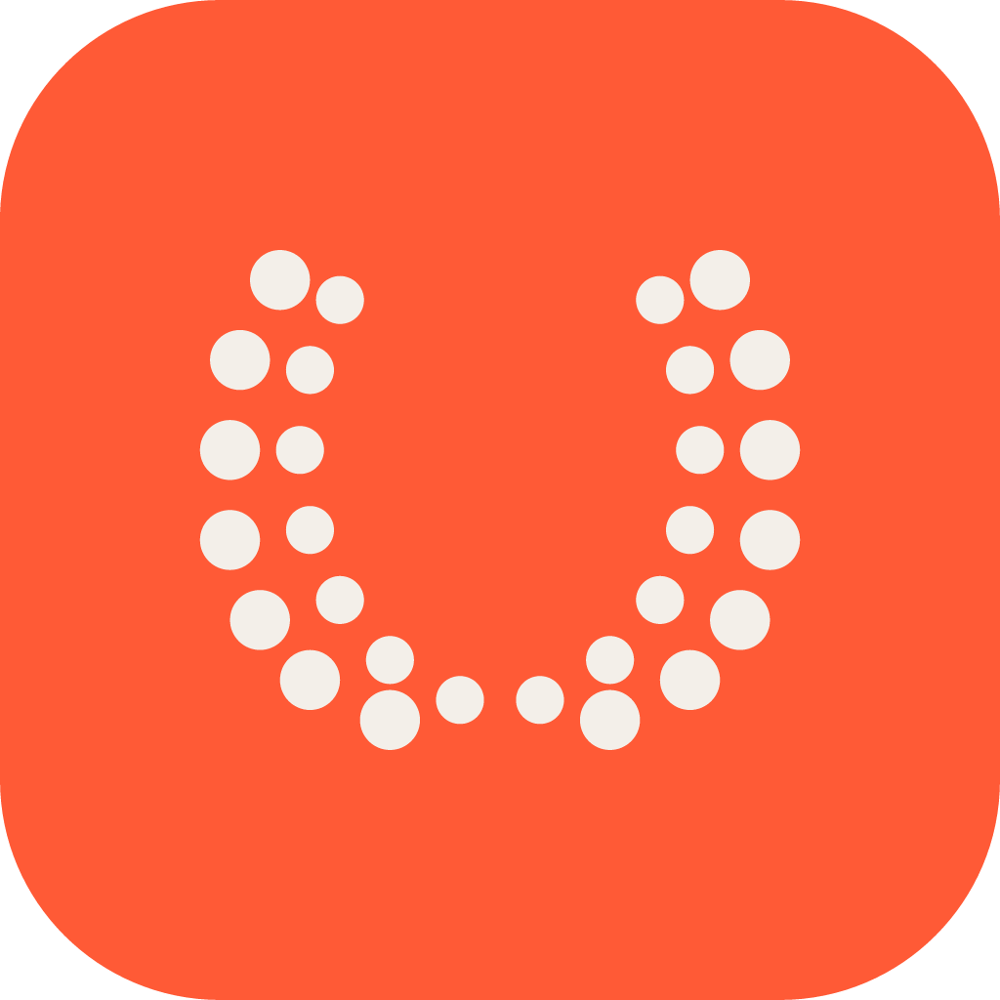<br>[svg](logos/compact-logo/compact-logo-white.svg) / [png](logos/compact-logo/compact-logo-white.png)</p> | <p align="center"><br>[svg](logos/compact-logo/compact-logo-white-bg.svg) / [png](logos/compact-logo/compact-logo-white-bg.png)</p> |

Previews of transparent files that would disappear on GitHub's light or dark theme show their background version; the links point to the transparent file.

**Usage**
- **Primary** is the default: coral laurel, light wordmark, dark background. Use **Black** on light backgrounds and **White** on coral.
- Keep strong contrast. Never put the coral laurel on coral, or the black logo on dark surfaces.
- Clear space: at least **half the logo's height** on every side.
- Don't stretch, rotate, recolor individual dots, or set the wordmark in another typeface. The wordmark is drawn in dots, so the files need no font installed.
- The compact logo (the laurel alone) is for avatars, favicons and small sizes. Below 24 px, use the version with background.

<br>

## Tier laurels

The laurel lights up bottom to top as a trader's reputation R crosses each tier. Use these wherever a tier is shown.

| No tier | Tier I · R ≥ 1 | Tier II · R ≥ 4 | Tier III · R ≥ 9 | Tier IV · R ≥ 16 | Tier V · R ≥ 36 |
|:---:|:---:|:---:|:---:|:---:|:---:|
| 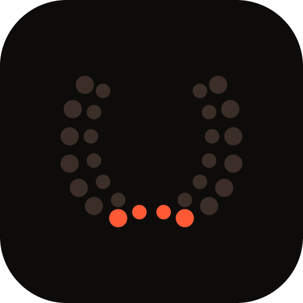 | 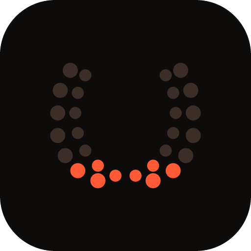 | 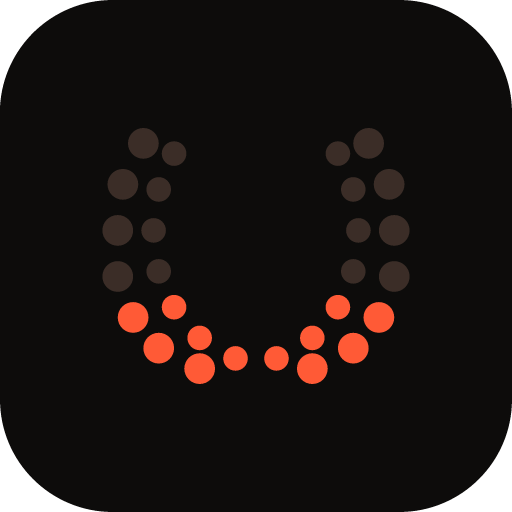 | 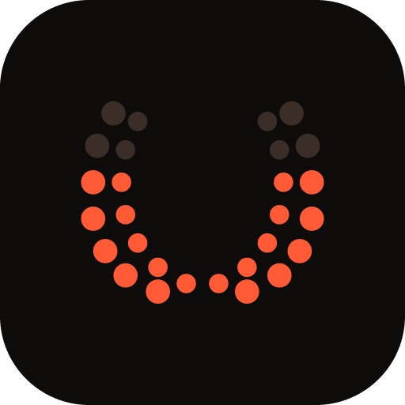 | 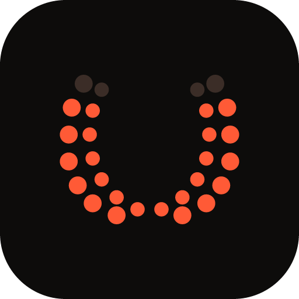 | 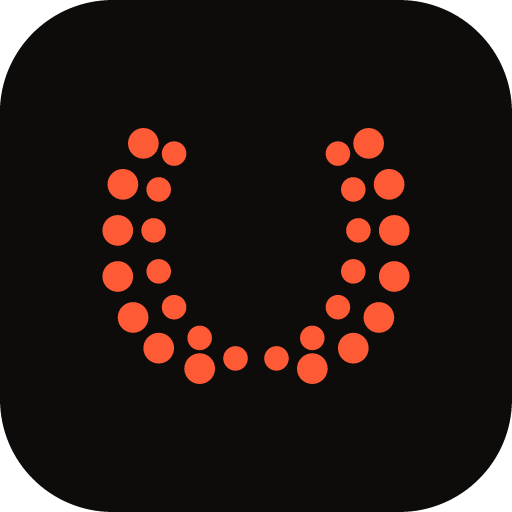 |
| [svg](tiers/tier-none.svg) | [svg](tiers/tier-I.svg) | [svg](tiers/tier-II.svg) | [svg](tiers/tier-III.svg) | [svg](tiers/tier-IV.svg) | [svg](tiers/tier-V.svg) |

<br>

## Palette

Coral is the signature: the laurel, YES, and the reputation-weighted price. Lavender is its counterpart: NO and the money-only price. The interface is dark only.

| Color | Swatch | Hex | Use |
|---|:---:|---|---|
| Coral |  | `#FF5A36` | Laurel, YES, reputation price, primary buttons |
| Lavender |  | `#9D97F5` | NO, money-only price |
| Ground |  | `#0D0C0B` | Background |
| Card |  | `#161413` | Surfaces |
| Ink |  | `#F3EFE9` | Text on dark |
| Muted |  | `#9A948C` | Secondary text, labels |
| Dot off |  | `#3B2D27` | Unlit laurel dots |

Never tell YES and NO apart by color alone: always label them.

<br>

## Typography

| Font | Usage | Download |
|---|---|---|
| **Doto** (900) | Odds, big numbers, the hero line. Dot-matrix, like the laurel | [Google Fonts ↗](https://fonts.google.com/specimen/Doto) |
| **Space Grotesk** (500) | Market questions and body text | [Google Fonts ↗](https://fonts.google.com/specimen/Space+Grotesk) |
| **IBM Plex Mono** (400/500) | Labels, status tags, addresses. Uppercase labels at 0.08em tracking | [Google Fonts ↗](https://fonts.google.com/specimen/IBM+Plex+Mono) |

The hero line ends with a blinking underscore: *YOUR TRACK RECORD IS WORTH MORE THAN THEIR BANKROLL_*

<br>

## Iconography

Icons are drawn on a 7×7 dot grid, like the wordmark: minimal, clear at small sizes, and built from the same dot as the laurel.

|  | 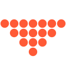 | 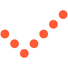 |  | 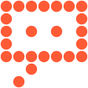 | 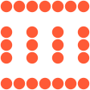 | 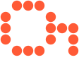 | 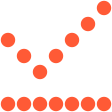 | 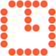 | 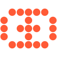 | 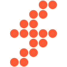 | 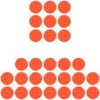 |
|:---:|:---:|:---:|:---:|:---:|:---:|:---:|:---:|:---:|:---:|:---:|:---:|
| upvote | downvote | check | cross | call | court | passkey | chart | clock | eye | bolt | user |

<br>

## Voice

Short, plain sentences. No hype. Numbers that can be checked. Say what Kleos doesn't fix as clearly as what it does.

<br>

## Rebuilding

Every file here is generated from `scripts/build.mjs`, so colors and shapes stay consistent.

```bash
cd brand && npm install && npm run build
```

The web app's tab icon (`web/src/app/icon.svg`) and home-screen icon (`web/src/app/apple-icon.png`) are copies of the compact primary logo with background.
