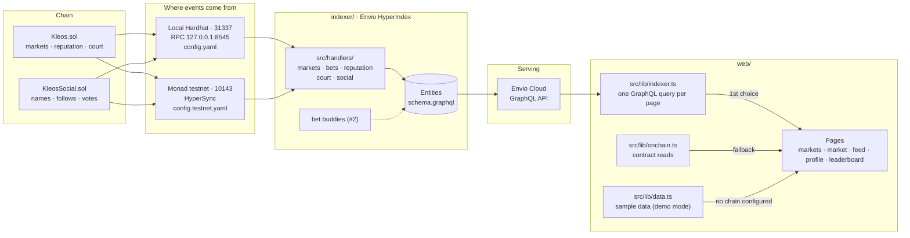
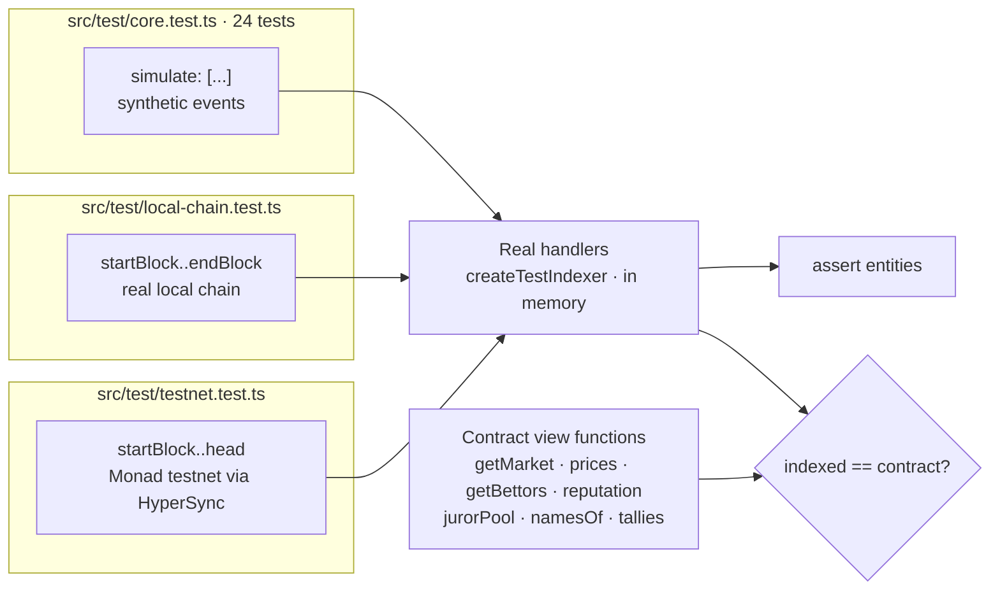
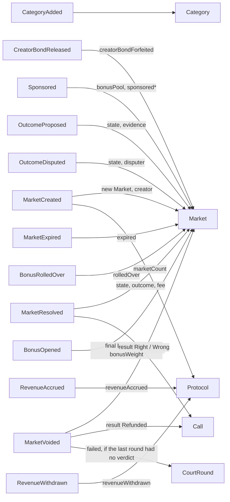
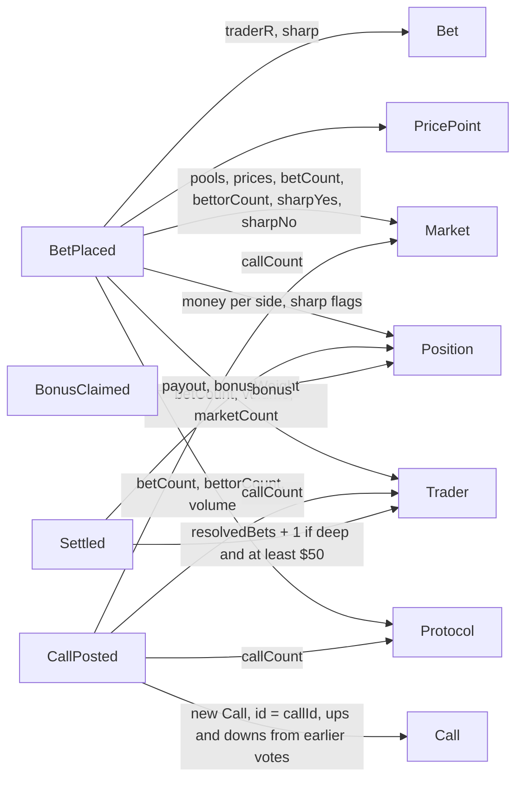
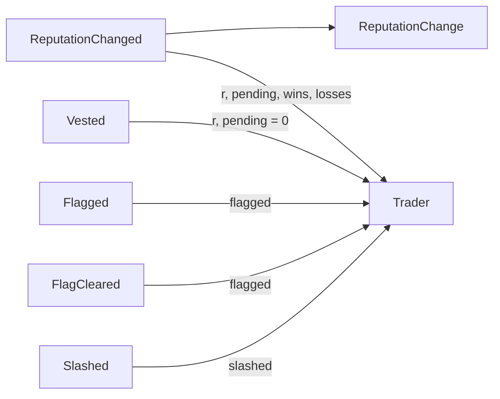
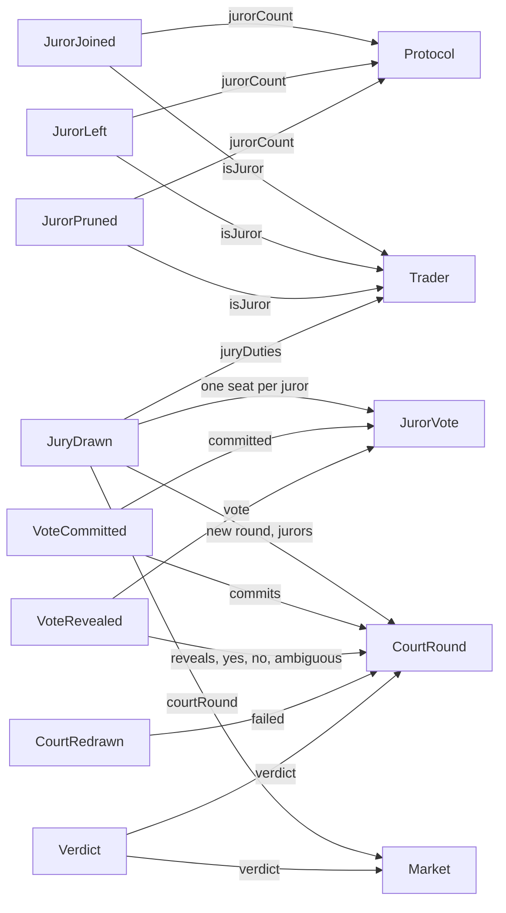
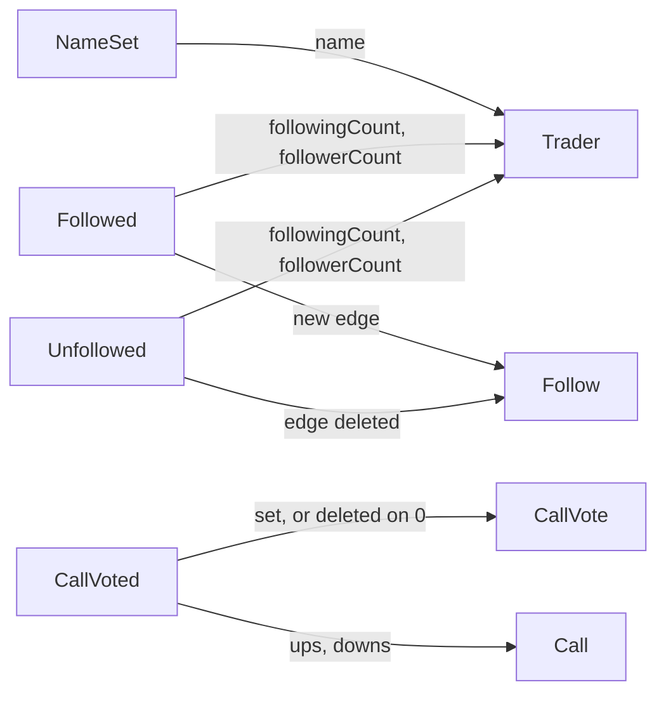
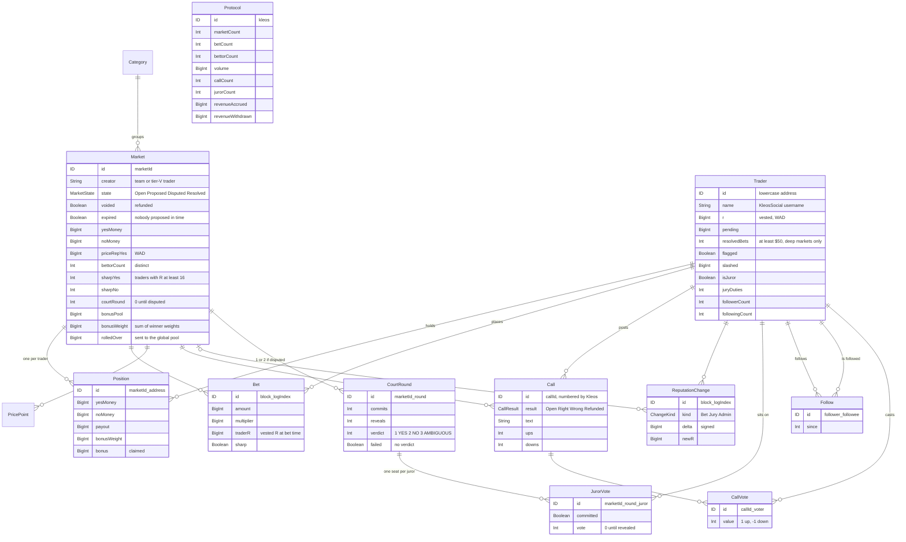
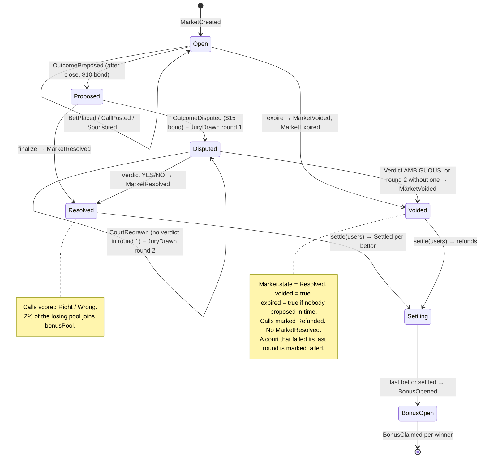
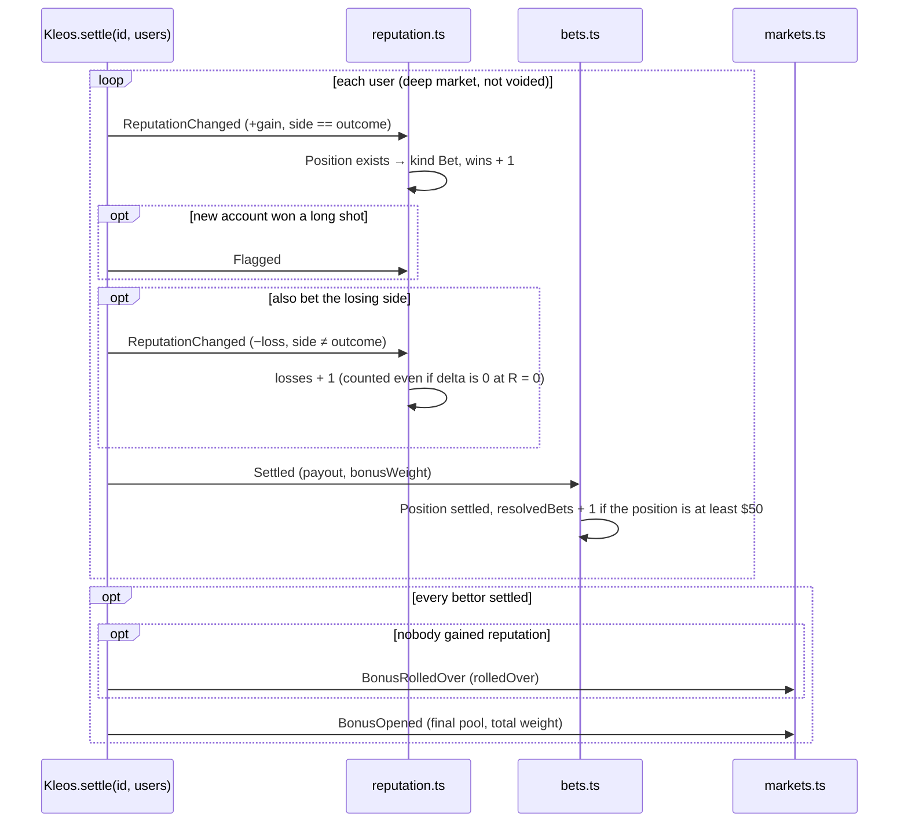

# Indexer architecture

How contract events become the data the app reads. Solid lines are built; dashed lines are planned.

Audit update, 2026-10-02: `BonusClaim`, `Vesting`, `Slash`, `OwnershipChange` and `ContractConfiguration` are now built. Claim state includes zero/non-position claims. Seed/reseed counts and current commitments use validated direct transaction input; omitted nested input is nullable unknown with provenance. Vest deadlines use recovered constructor parameters or the verified immutable snapshot for the exact deployed testnet address. Both integration suites pin comparisons to their indexed end block and count skipped fields. The historical diagrams below show the original core layout; current field details are in `schema.graphql`.

Main re-evaluation, `83e7909`: the combined candidate retains `PendingCallTally` for votes preceding a call and main's batched jury reads. Calls now carry numeric block/log positions and contract source, with matching history indexes. Envio's built-in `_meta.progressBlock` is the processing checkpoint; the maximum event block does not prove processing through quiet blocks. The adapter must validate checkpoint chain, replay start, readiness and freshness in the same operation as its data, and pin exact contract comparisons to that block. The candidate passes 36 simulated tests and actual isolated local handler replay at block 517, including a successful three-seat court, 11 bonus claims and 6 vest transitions. Hosted GraphQL acceptance remains open; the existing Cloud deployment remains its recorded historical schema.

## 1. The big picture

Both configs list the same contracts and events. Only the chain, the addresses and the data source differ. Envio Cloud runs `config.testnet.yaml`.

In live mode, pages prefer a validated indexer snapshot and fall back to bounded contract reads. Failure shows unavailable data. Samples are used only without configured contracts in demo mode.

Testnet is read through HyperSync. Envio Cloud gives hosted indexers HyperSync access without a token. Running the testnet config locally needs `ENVIO_API_TOKEN` in `indexer/.env`. The start block is 67114786, where KleosSocial was deployed; Kleos followed in 67114811.

## 2. How we test it without Docker

- `pnpm test` runs the simulated tests and the local-chain test. The local-chain test skips itself unless the local chain is running with the contracts deployed (`dev-stack` skill).
- `pnpm test:testnet` runs `scripts/test-testnet.sh`. It swaps `config.testnet.yaml` in for `config.yaml`, runs the real handlers over the live deployment, compares markets, prices, bettors, reputation, the juror pool, names, follows and vote tallies with the contracts, and swaps the config back. It needs `ENVIO_API_TOKEN`.

## 3. Which event updates what

One diagram per handler file. The labels on the arrows name the fields each event changes.

**`src/handlers/markets.ts`: the market lifecycle**

\* `sponsored` skips top-ups from the global pool (sponsor = the Kleos contract itself).

**`src/handlers/bets.ts`: trading and settlement**

The sharp signal counts each trader once per side, by their vested R at bet time. Sharp means R of at least 16 (tier IV).

**`src/handlers/reputation.ts`: reputation**

`ReputationChanged` also reads the trader's `Position` in that market to label the change: Bet if one exists, Jury if not (jurors can never hold one), Admin for market 0. After a `Slashed`, the `ReputationChanged` with market 0 sets R and pending.

**`src/handlers/court.ts`: Kleos Court**

Seats are created when the jury is drawn, so jurors who never commit or reveal stay visible.

**`src/handlers/social.ts`: KleosSocial**

KleosSocial doesn't check that a call exists, so a vote can arrive before its `CallPosted`. The `CallPosted` handler counts the votes already stored. Social data never touches money or reputation.

`OwnershipTransferred` is now indexed, because the owner affects eligibility exceptions even when no screen displays it.

## 4. The entities

`Protocol` is a single row of totals. Envio Cloud has no `_aggregate` queries, so totals and per-entity counters (`bettorCount`, `callCount`, `followerCount` and so on) are kept up to date by the handlers.

Planned: `BuddyPair` (#2).

## 5. A market's life, and what the indexer does at each step

`propose`, `expire`, `sponsor` and `fundFromGlobal` reject market ids that were never created, so every market event follows its `MarketCreated`. The market handlers still look markets up with `knownMarket`, which logs a warning and skips the event instead of halting the indexer.

## 6. Inside one settle, in event order

Order within a transaction matters: the handlers rely on the `Position` already existing (it was created at bet time) and on `BonusOpened` coming last.

In a voided market or a shallow one, `Settled` comes alone: no reputation changes and no `resolvedBets`.

In a court with a verdict, the jurors' `ReputationChanged` events come right after `Verdict` and before `MarketResolved` or `MarketVoided`. When the court fails its last round, `MarketVoided` comes first and the no-show penalties follow. Jurors never hold a position, so their changes are recorded as `Jury` either way.
