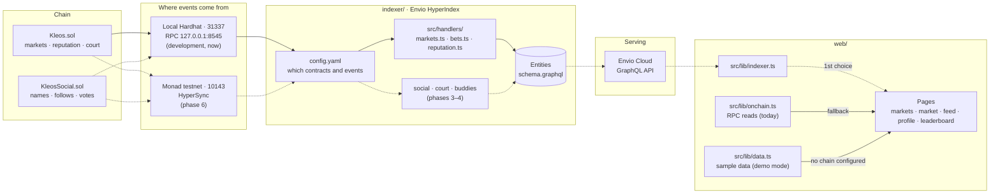
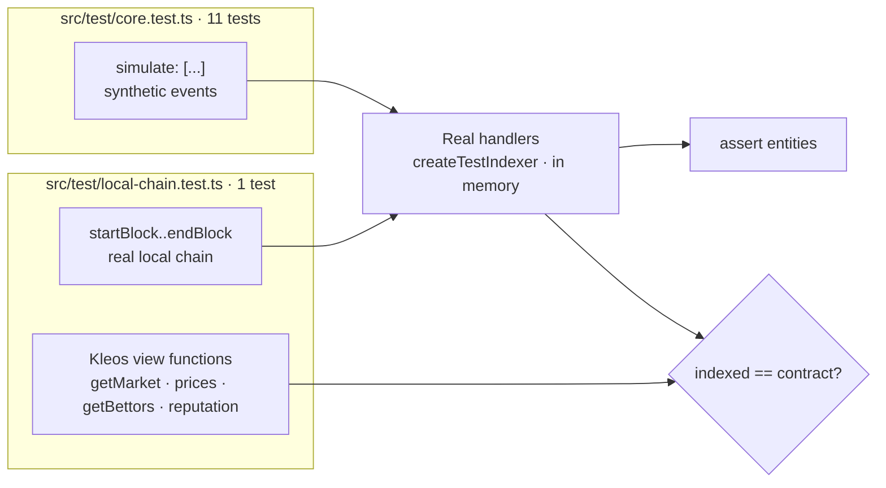
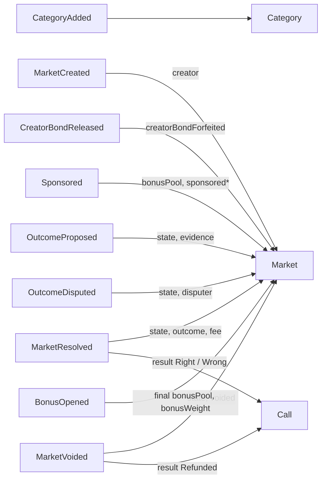
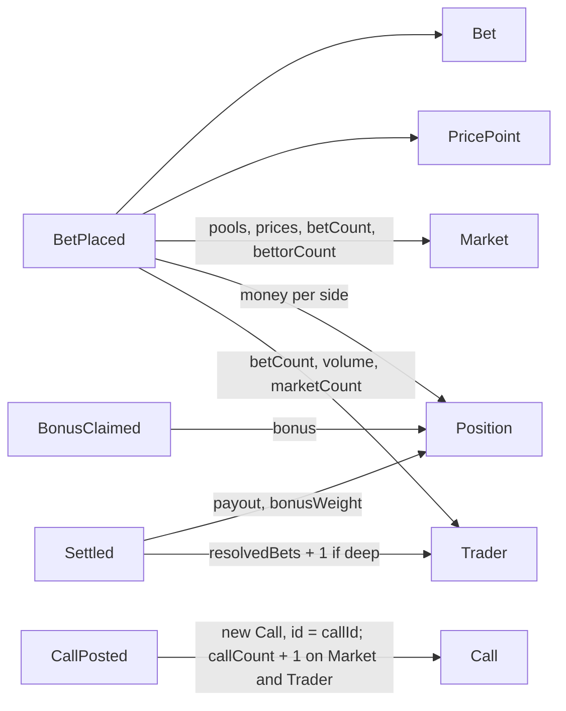
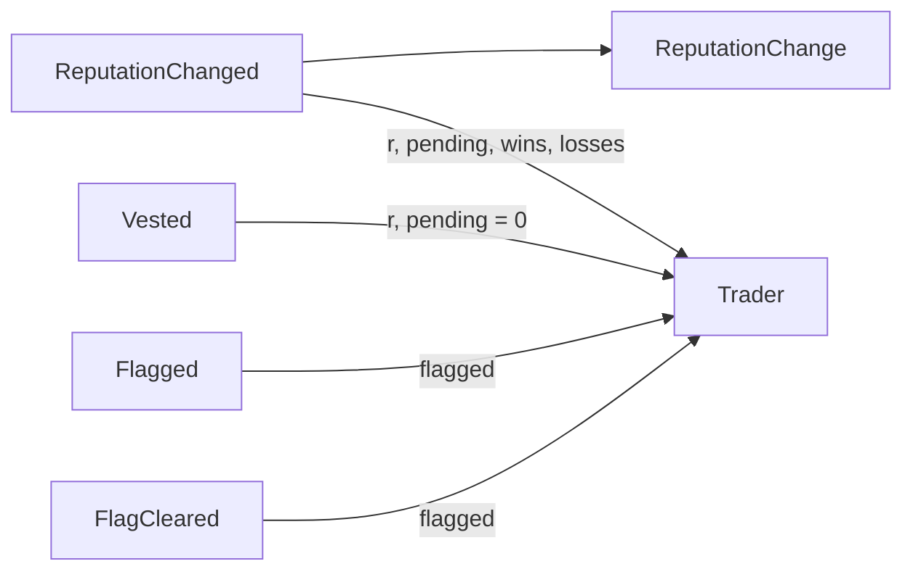
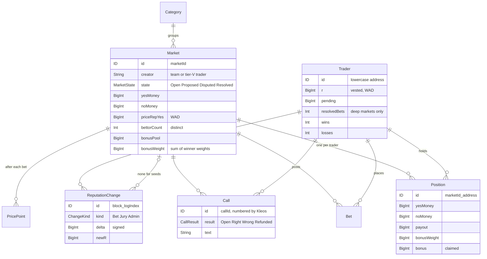
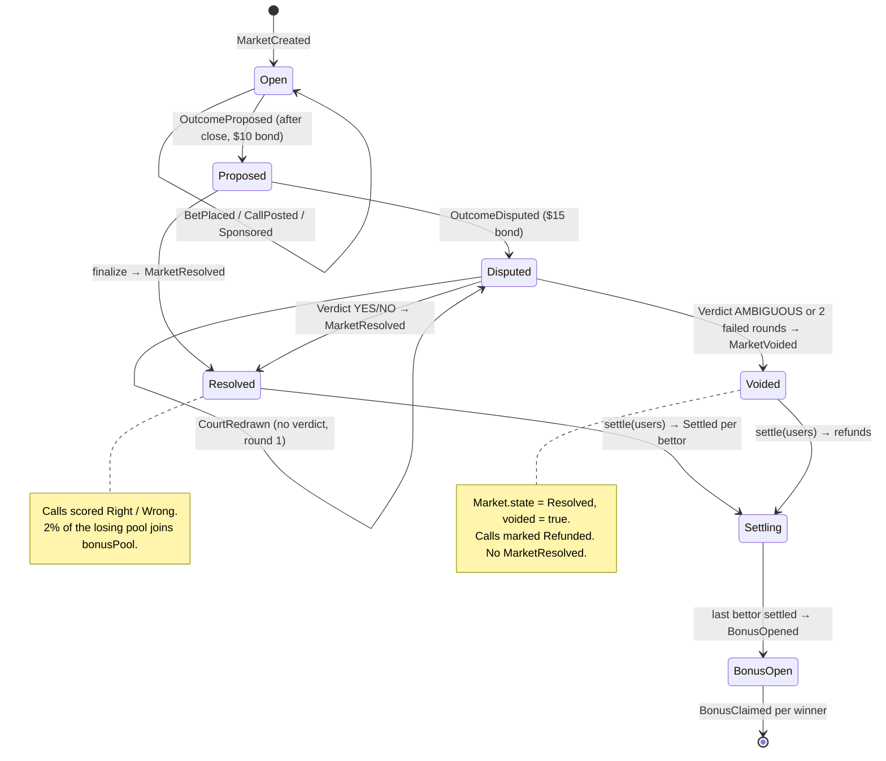
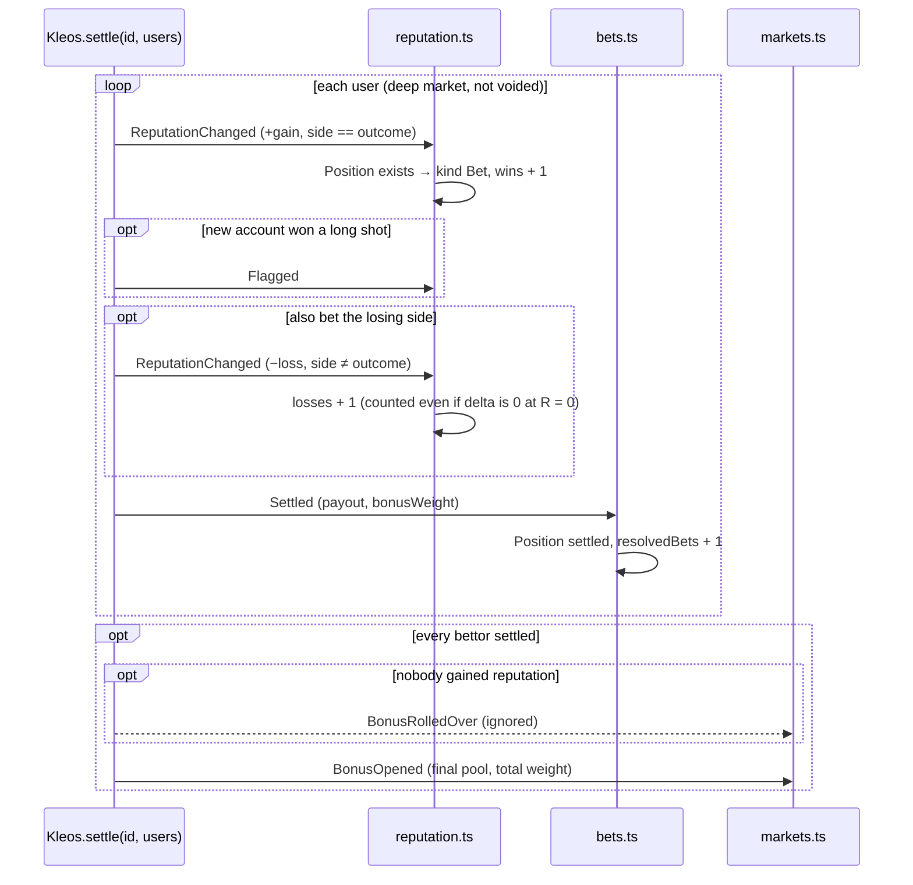

# Indexer architecture

How contract events become the data the app reads. Solid lines are built; dashed lines are planned.

## 1. The big picture

Pages pick the first source that's configured: indexer, then RPC, then sample data. Only the indexer path is new. The other two keep working throughout.

## 2. How we test it without Docker

The integration test skips itself unless the local chain is running with the contracts deployed (`dev-stack` skill).

## 3. Which event updates what

One diagram per handler file. The labels on the arrows name the fields each event changes.

**`src/handlers/markets.ts`: the market lifecycle**

**`src/handlers/bets.ts`: trading and settlement**

**`src/handlers/reputation.ts`: reputation**

`ReputationChanged` also reads the trader's `Position` in that market to label the change: Bet if one exists, Jury if not (jurors can never hold one), Admin for market 0.

\* `sponsored` skips top-ups from the global pool (sponsor = the Kleos contract itself).

Not handled on purpose:
- `BonusRolledOver`: the `BonusOpened` right after it carries the final pool.
- `Slashed`: the `ReputationChanged` in the same transaction carries the result.
- `RevenueAccrued`, `RevenueWithdrawn`: protocol revenue isn't shown anywhere or scored. The creation-fee `RevenueAccrued` also comes before its `MarketCreated`.

Not handled yet (phase 3): the court events (`JuryDrawn`, `VoteCommitted`, `VoteRevealed`, `CourtRedrawn`, `Verdict`), `JurorJoined`/`JurorLeft`, and everything from `KleosSocial`.

## 4. The entities

Planned: `BuddyPair` (#2), `CourtRound`, `SharpSignal`, and `Follow`, plus names and vote counts from `KleosSocial`.

## 5. A market's life, and what the indexer does at each step

A market id that was never created can still reach `Proposed` and beyond, because `Kleos.propose` doesn't check that the market exists. The market handlers skip these events (`knownMarket`) instead of halting. This contract behavior requires a bounds check.

## 6. Inside one settle, in event order

Order within a transaction matters: the handlers rely on the `Position` already existing (it was created at bet time) and on `BonusOpened` coming last.

In a court, the jurors' `ReputationChanged` events come right after `Verdict` and before `MarketResolved`. Jurors never hold a position, so they're recorded as `Jury`.
